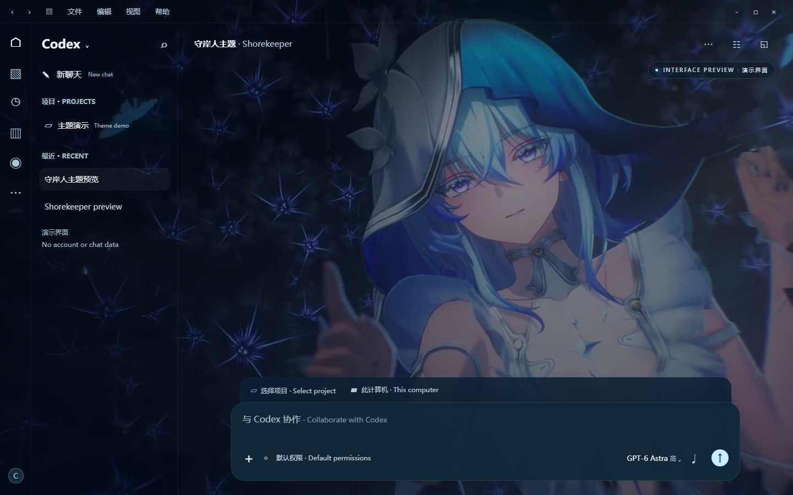
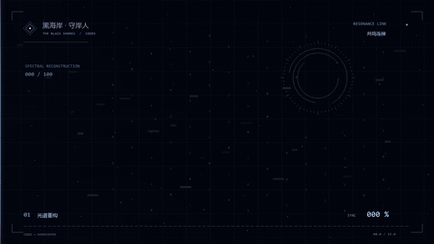

# Codex 守岸人主题 · Shorekeeper Theme for Codex

中文 / English · Windows x64 · v3

为 Codex 添加守岸人启动动画和动态视频背景，并提供可恢复的安装流程。

Add a Shorekeeper startup animation and video background to Codex, with a reversible installation workflow.

## 效果预览 · Preview

### 主界面示意 · Interface illustration



使用主题素材制作的演示界面，不含账号或聊天记录，并非应用实际运行截图。

An interface illustration built from theme assets, without account or chat data. It is not a screenshot of the running application.

### 启动动画 · Startup animation



从发布包中的真实启动视频生成的约 15 秒循环预览；GIF 已降低分辨率与帧率，完整效果以安装包为准。

A roughly 15-second looping preview generated from the packaged startup video. Resolution and frame rate are reduced for the GIF; see the package for full quality.

## 下载与文档 · Downloads and documentation

- [下载 v3 分享包 · Download the v3 package](https://github.com/jiang050504/codex-shorekeeper-theme/releases/download/v3.0.0/Codex-Shorekeeper-Share-v3.zip)
- [全部发布附件 · All release assets](https://github.com/jiang050504/codex-shorekeeper-theme/releases/tag/v3.0.0)
- [中英双语使用说明 · Bilingual user guide](docs/Guide.zh-en.md)
- [中文版 PDF · Chinese PDF guide](https://github.com/jiang050504/codex-shorekeeper-theme/releases/download/v3.0.0/Codex-Shorekeeper-v3-Guide-zh-CN.pdf)

**请下载 Release 中的分享包 ZIP。GitHub 自动生成的 Source code 压缩包仅包含仓库文件，不能代替安装分享包。**

**Download the package ZIP from the release assets. GitHub's automatically generated Source code archives contain repository files and are not the installable theme package.**

## 功能 · Features

- 守岸人启动动画、数字扫描效果和动态视频背景。Shorekeeper startup animation, digital scanning effects, and a video background.
- 深蓝色按钮与套餐卡片，侧栏使用浅色文字。Dark navy buttons and usage cards, with light sidebar text.
- 默认识别接收电脑的 Codex 版本和资源结构。Detects the recipient computer's installed version and resource structure.
- 可写安装目录直接原位更新。Updates writable installations in place.
- 商店目录受保护时，先询问是否安装独立版及其位置；保留商店原版。For protected Store installations, asks whether and where to install a standalone copy, while retaining the Store version.
- 独立版沿用应用原生默认数据逻辑，整合可修改的启动入口，保留恢复备份。The standalone copy uses the app's native default profile logic, integrates writable launch entries, and keeps recovery backups.

## 快速安装 · Quick start

1. 接收电脑先安装并正常登录 Codex，再完整解压分享包。Install Codex and sign in on the recipient computer, then fully extract the theme package.
2. 运行 `Check.cmd`，核对检测到的版本和真实安装目录。Run `Check.cmd` and verify the detected version and installation path.
3. 运行 `Install.cmd`，按提示操作；需要独立版时，选择一个正式的空目录。Run `Install.cmd`; if a standalone copy is required, choose an empty permanent installation directory.
4. 通过“文件 → 退出”完全退出目标 Codex，等待安装完成。Fully quit the target Codex using its exit menu and let installation finish.
5. 从桌面或开始菜单的 `Codex` 入口打开。Launch `Codex` from the desktop or Start menu.

## 入口整合与恢复 · Launch integration and recovery

已有 v2 独立版：先运行 `Install.cmd` 选择现有独立版原位更新，再运行 `Integrate.cmd`，按提示指定原 Codex 的安装目录。

For an existing v2 standalone installation, update it in place with `Install.cmd`, then run `Integrate.cmd` and identify the original Codex installation when prompted.

`Restore.cmd` 会先恢复原快捷方式和协议登记，再恢复上次安装前的程序文件。请保留安装目录中的 `.shorekeeper` 备份。

`Restore.cmd` restores the original shortcuts and protocol registration, then the program files from before the most recent installation. Keep the `.shorekeeper` backups in the installation directory.

## 兼容范围与限制 · Compatibility and limitations

当前适配器面向符合已识别资源结构的 Windows x64 构建，不能保证所有历史或未来版本。未知结构会停止安装。模拟修改版本号和 CSS 类名的测试，不代表所有真实发行版都已完成运行验证。

The adapter targets Windows x64 builds with recognized resource structures. It does not guarantee support for every past or future version, and stops on unknown structures. Tests using simulated version numbers and CSS class changes do not establish runtime compatibility with every real release.

商店应用库中的受保护原入口仍打开商店原版。任务栏缓存或系统默认协议可能需要手动重新选择。官方更新可能覆盖主题，独立版不承诺与商店自动同步。

Protected Store library entries still launch the Store version. Cached taskbar pins or default protocol choices may need manual adjustment. Official updates may overwrite the theme, and the standalone copy is not guaranteed to update alongside the Store app.

本工具保留 CSP 和资源完整性检查，并更新修改资源对应的摘要；修改后的主程序不再具有原厂文件的有效签名。账号和聊天能否直接读取，取决于本机账户、版本和系统访问条件；分享包不迁移其他人的账号。

The tool retains CSP and resource integrity checks and updates the digests for modified resources. The modified executable no longer retains a valid original-vendor signature. Access to existing accounts and chats depends on the local account, version, and system access conditions; the package does not transfer another person's account.

## 完整性校验 · Integrity check

`Codex-Shorekeeper-Share-v3.zip` SHA256:

```text
8c39a6799f79f695cf4f928a1352fb48ad623d9b61672b09e0ad838fc4db785f
```

## 素材与隐私 · Media and privacy

分享包不包含个人账号、聊天记录、Cookie、密钥或测试日志。请只分享发布附件，不要上传个人运行目录或 `.shorekeeper` 备份。

The package excludes personal accounts, chats, cookies, keys, and test logs. Share the release assets rather than your personal runtime directory or `.shorekeeper` backups.

这是非官方的本地主题定制项目，与 OpenAI 或游戏权利方无隶属关系。游戏角色和原视频的权利归各自权利方所有，发布本项目不授予这些素材的版权许可。

This is an unofficial local theme customization project, unaffiliated with OpenAI or the game's rights holders. The game character and original video remain the property of their respective rights holders; publishing this project does not grant copyright permissions for those media.
